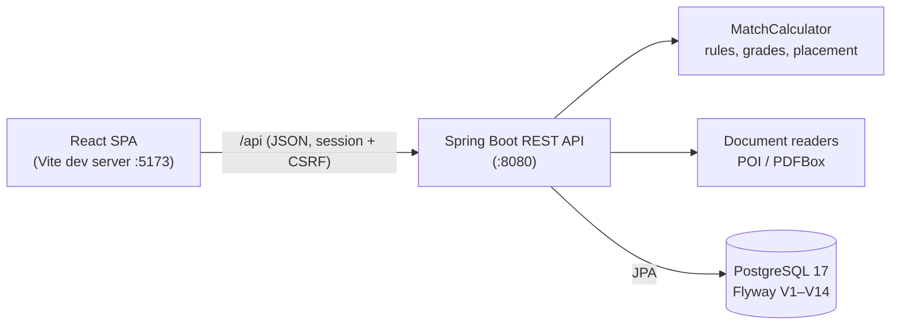

# Credit Transfer System (İntibak Sistemi)

> 🇹🇷 **Türkçe özet:** Yalova Üniversitesi Bilgisayar Mühendisliği bölümü intibak komisyonu için geliştirilen web
> uygulaması. Yatay/dikey geçişle gelen öğrencinin önceki üniversitede aldığı dersler Yalova ders planıyla
> eşleştirilir, notlar seçilen dönüşüm tablosuyla (PT) Yalova harf notuna çevrilir, sayılan krediye göre sınıf/dönem
> önerilir. Sistem öneri yapar; son kararı her zaman komisyon verir. Ayrıntılı kurallar:
> [`docs/eslestirme-kurallari.md`](docs/eslestirme-kurallari.md).


## Overview

When a student transfers into the Computer Engineering department of Yalova University, an *intibak* (course
recognition) commission decides which of the student's previously completed courses count toward the Yalova
curriculum, what grade each recognised course receives, and which class/semester the student starts in. The decision
is recorded on an official form.

Done by hand, this means comparing transcripts line by line against the curriculum, converting grades from other
grading systems and adding up credits. This application turns that work into a guided, auditable workflow:

- the student's full course list is entered once and compared side by side with the Yalova curriculum,
- obvious matches are suggested automatically, the rest are compared by course content,
- grades are converted and the class/semester placement is calculated live,
- **every result is a suggestion** — the commission can override any of them, and nothing is saved until a member
  explicitly confirms the form.

## Features

**Course matching**

- Two-column comparison screen: the student's courses (matched and unmatched) on the left, the selected Yalova
  curriculum grouped by semester on the right; clicking a course shows its content.
- One-click auto-match for courses with the same name (case, punctuation and `I/II` ↔ `1/2` differences ignored) and
  for the national common courses (Turkish Language, Atatürk's Principles and History of Revolution).
- Manual matching for everything else, including many-to-one and one-to-many matches.
- Topic-by-topic content comparison with a coverage percentage (no fixed threshold — the commission decides).
- Rule-based warnings that never block the commission: language mismatch, English-preparation requirement, failing
  grades, and Yalova courses that have neither content nor a same-name counterpart.

**Grades and placement**

- Configurable grade conversion tables (100-point, letter and other systems) mapped to Yalova letter grades.
- Live preview of converted grades, combined grades for many-to-one matches and counted credits.
- Class/semester suggestion from counted credits (and transfer type), with a commission override.

**Records and documents**

- Record list with status tracking (being created, being changed, exported, cancelled), search and soft cancel.
- Transcript and course-content documents (PDF/DOCX) stored per record; the course-content section for a course is
  located in the document automatically.
- Multiple records for the same student (one per previous university) are linked by national ID.

**Administration**

- Curriculum plans imported from Excel, with course contents imported from PDF/DOCX catalogues.
- Active academic year that decides which curriculum applies to each class.
- Four fixed role accounts (chair, two members, secretary) with editable display names (title and full name).

## Tech stack

| Layer | Technology |
|---|---|
| Backend | Java 21, Spring Boot 4.1 (Web MVC, Data JPA, Security, Validation), Maven Wrapper |
| Database | PostgreSQL 17 (Docker Compose), schema migrations with Flyway |
| Documents | Apache POI (Excel/Word), Apache PDFBox (PDF text) |
| Frontend | React 19, TypeScript, Vite, Material UI, React Router |
| Testing | JUnit 5, Mockito, Spring MVC tests · Vitest, Testing Library, jsdom |

## Architecture



- **Single source of truth for rules.** All matching, grade and placement rules live in the backend
  (`MatchCalculator`). The form calls `POST /api/records/evaluate` as the user types and only renders the result, so
  the preview and the saved record can never disagree.
- **Schema is owned by Flyway.** Hibernate runs with `ddl-auto=validate`; every schema change is a versioned
  migration in `backend/src/main/resources/db/migration`.
- **Security.** Session-based login with CSRF protection and BCrypt password hashes. The database port is bound to
  `127.0.0.1` only, and secrets are read from a local `.env` file that is never committed.

## Getting started

### Prerequisites

- Java 21 (Maven is not required — the bundled Maven Wrapper is used)
- Node.js 22 LTS or newer, with npm
- Docker Desktop (for PostgreSQL)

### 1. Configure secrets

```bash
cp .env.example .env
```

Set a strong `POSTGRES_PASSWORD` in `.env`. Both Docker Compose and Spring Boot read it from there.

### 2. Start the database

```bash
docker compose up -d
```

PostgreSQL listens on `127.0.0.1:5433`.

### 3. Start the backend

```bash
cd backend
./mvnw spring-boot:run        # Windows: mvnw.cmd spring-boot:run
```

Flyway creates the schema on first start. The API runs on <http://localhost:8080>.

### 4. Start the frontend

```bash
cd frontend
npm install
npm run dev
```

Open <http://localhost:5173>. The dev server proxies `/api` to the backend.

### First login

The four role accounts are created without passwords; the first password entered for an account becomes its
password. Set all four passwords before giving anyone else access, and change the display names under
*Settings → Users*. Curricula (`docs/ders-planlari`) and course contents (`docs/ders-icerikleri`) are loaded from the
*Settings → Curriculum plans* screen.

## Testing

```bash
cd backend && ./mvnw test      # unit and Spring MVC tests
cd frontend && npm test        # Vitest component and unit tests
cd frontend && npm run lint    # ESLint
```

## Project structure

```text
backend/
  src/main/java/tr/edu/yalova/intibak/
    record/       intibak records, matching rules (MatchCalculator), documents
    curriculum/   curriculum plans and course contents
    grade/        grade conversion tables
    content/      course-content document reader (PDF/DOCX)
    setting/      active academic year
    user/ security/ common/ system/
  src/main/resources/
    db/migration/ Flyway migrations (V1–V14)
    templates/    Word template of the official form
frontend/
  src/pages/      screens (records, form, settings)
  src/records/    matching table, comparison board, helpers and tests
docs/
  eslestirme-kurallari.md   matching rules agreed with the commission (source of truth)
  mockup/                   clickable HTML mockup of all screens
  word-cikti/               Word output template guide and exporter draft
  ders-planlari/            curriculum Excel files
  ders-icerikleri/          course content catalogues
compose.yaml                PostgreSQL for development
```

## Matching rules

The rules were agreed with the commission and are documented in Turkish in
[`docs/eslestirme-kurallari.md`](docs/eslestirme-kurallari.md). In short:

| # | Situation | System suggestion |
|---|---|---|
| 1 | Yalova course is English, incoming course is Turkish | Not counted |
| 2 / 2b | Incoming course is English | Evaluated further; requires passed English preparation or a ≥30% English department |
| 3 | Turkish Language / Atatürk's Principles courses | Accepted directly |
| 4 | Same course name | Accepted directly |
| 5 | Different names | Content comparison; the commission decides |
| 5b | Different names and the Yalova course has no content | Not matched, flagged with a red mark |
| 7 | Counted credits < 30 / 30–60 / > 60 | 1st class / 2nd class (3rd sem.) / 3rd class (5th sem.); DGS → 5th semester |
| 8 | Any of the above | The commission can override every suggestion |

## Privacy

Transcripts contain personal data protected under Turkish data-protection law (KVKK). The application is designed to
run on university infrastructure: documents are stored only in its own database, national IDs are masked in lists,
and no student data is sent to external services. Planned AI features will use locally hosted models only.

## Roadmap

- [x] Users, active year, grade tables, curriculum plans and course contents
- [x] Intibak records, matching rules, content comparison and placement
- [x] Student course list and two-column comparison screen with auto-matching
- [ ] Word export of the official intibak form
- [ ] Transcript reading with a locally hosted vision-language model
- [ ] Semantic content similarity (local embeddings + pgvector)
- [ ] Deployment hardening (rate limiting, production configuration, CI)
